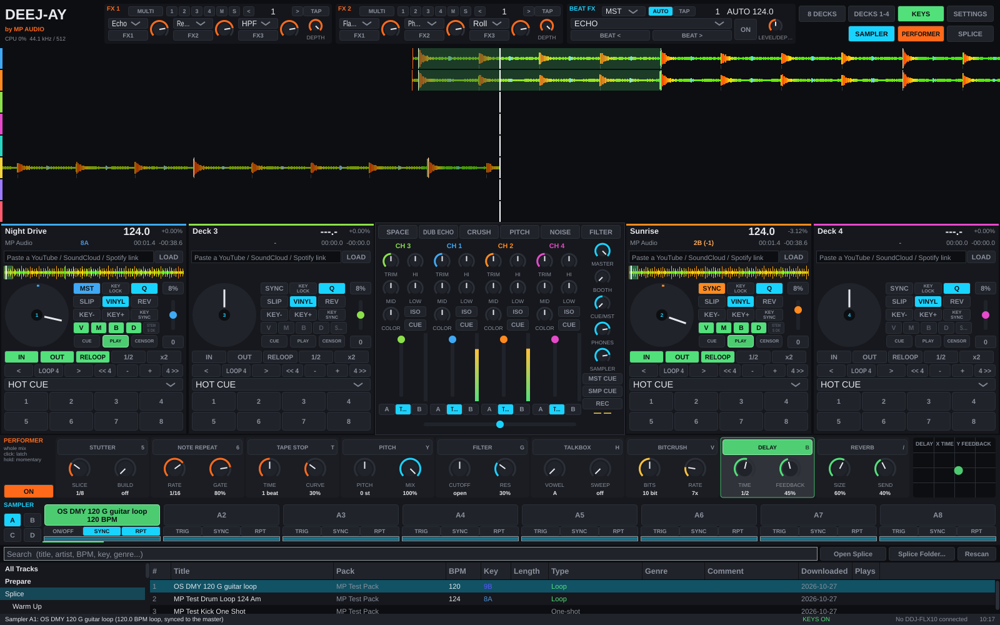

# DEEJ-AY by MP Audio

Native macOS DJ software built around the Pioneer DJ DDJ-FLX10 and the Serato DJ Pro workflow: the same
decks, pads, loops, FX and sampler, with its own engine, analysis and look.

## What it does
- **Eight decks.** Two, four or eight decks on screen. With eight, DECKS 1-4 / 5-8 flips the bank on screen
  and on the DDJ-FLX10 (SHIFT + VIEW).
  - Each deck has CDJ cue, 8 hot cues and 8 saved loop slots.
  - Auto and manual loops, rolls, slicer, slip, censor, reverse, beat jump, vinyl scratch and pitch bend.
  - Tempo ranges ±8 / 16 / 50 %; key lock, key shift, key sync and Pitch Play.
  - Smart Sync with leader selection and half/double-tempo matching.
  - **Double-click CUE** plays the track from the top.
- **URL box on every deck.**
  - YouTube or SoundCloud links are downloaded with yt-dlp, analysed, and ready to remix. The user installs
    yt-dlp; it is not bundled. See *Links* below.
  - Spotify links load the user's own copy from the library.
- **Twelve pad modes.** Hot Cue, Saved Loop, Pitch Play, Pad FX, Roll, Beat Jump, Auto Loop, Sampler, Key
  Shift, Slicer, Slicer Loop and Stems.
- **Stems.** Vocals, melody, bass and drums are separated in the background. ACTIVE PART mutes stems, Part
  ISO turns the EQ into stem faders, and Part Instant Doubles copies a stem to another deck.
- **Mixer.** Eight channels, four on screen per bank, with:
  - trim, DJM-style EQ or isolator;
  - six Sound Color FX (SPACE, DUB ECHO, CRUSH, PITCH, NOISE, FILTER);
  - adjustable fader and crossfader curves, headphone cue with split cue, booth output, and recording.
- **Performer.** Performance FX on the whole mix: every deck and the sampler go through it.
  - The effects: stutter (with build-up), note repeat (with gate), tape stop, pitch ±12, filter, talkbox
    (vowel formants, optional beat-synced sweep), bitcrusher, ping-pong delay and reverb.
  - Rhythmic values lock to the master tempo and beat.
  - Click a tile to latch it; hold it for momentary. The XY pad plays the selected effect.
- **FX.**
  - Two Serato-style FX units (MULTI / SINGLE).
  - The 14 FLX10 BEAT FX, assignable to channels 1-8, the master or the sampler.
- **Sampler.** 4 banks × 8 slots in trigger / hold / on-off modes.
  - SYNC matches a slot to the master tempo with key lock, so loops keep their pitch.
  - A synced slot launches on the next beat. Repeating loops are cut to whole beats so they stay in phase.
- **Splice.** Sounds downloaded with the Splice app are listed in the library, with BPM, key and loop or
  one-shot read from the names. Drag them onto a sampler pad (they load synced to the master) or onto a deck.
- **Analysis.**
  - BPM and beatgrid, key (Camelot), loudness for auto gain, and a three-band colour waveform.
  - New tracks are analysed in the background on import, or with Analyse.
  - The key display follows key shift and, without key lock, the tempo fader's pitch.
  - Serato's own cues, loops and grids are imported from tags.
- **Library.**
  - Crates and nested crates, smart crates, Prepare, and history.
  - Import of Serato crates.
  - Search and sortable columns, and drag and drop.
- **Controllers.**
  - Full DDJ-FLX10 mapping with LEDs, On Jog Displays and the deck layer (`docs/CONTROLLER-FLX10.md`).
  - The computer keyboard works as a controller (the KEYS button: decks, hot cues, loops, Performer and
    sampler pads; Settings > Keyboard).

## Links, Splice and Spotify: what is and is not possible
- **YouTube / SoundCloud.** DEEJ-AY runs [yt-dlp](https://github.com/yt-dlp/yt-dlp), which the user installs
  (`brew install yt-dlp`; ffmpeg recommended). It is not bundled.
  - Downloading may break the service's terms, and the music is usually copyrighted. Use it for material you
    have the rights to.
  - Downloads go to `~/Music/DEEJ-AY Downloads` and into a "Downloads" crate.
- **Spotify.** Spotify audio is DRM-protected, and Spotify's developer terms forbid DJ apps. No legitimate app
  can play a Spotify stream into a mixer. A Spotify link makes DEEJ-AY look up the track title (Spotify's
  public link preview) and load the user's own copy from the library.
- **Splice.** Splice has no public sign-in API for third-party apps.
  - Sign in and browse in the Splice desktop app (the Open Splice button).
  - DEEJ-AY reads the folder the Splice app downloads into (`~/Splice/sounds` by default, configurable).
  - DEEJ-AY never handles Splice credentials.

## Building
Requirements: macOS 13+, Xcode 15+ (or the Command Line Tools), CMake 3.22+ and Ninja. JUCE 9 is fetched
at configure time.

    cmake -S DeejAy -B build -G Ninja -DCMAKE_BUILD_TYPE=Release
    cmake --build build --target DeejAy -j
    open build/DeejAy_artefacts/Release/DEEJ-AY.app

The engine and its tests build anywhere, without JUCE:

    cmake -S DeejAy -B build-engine -DDEEJAY_BUILD_APP=OFF
    cmake --build build-engine -j && ./build-engine/deejay_tests

Signing, notarization and the DMG are covered in `docs/RELEASE.md`. CI does all of it on every push.

## Layout
| Path | What |
|---|---|
| `engine/dj/` | Real-time engine (no JUCE): decks, mixer, FX, sampler, analysis, library, FLX10 mapping |
| `app/` | JUCE application: audio and MIDI hosting, UI, settings |
| `tests/` | Engine, analysis, library and controller tests |
| `packaging/` | Entitlements, signing / notarization and DMG scripts |
| `docs/` | Design notes, controller mapping, roadmap, release process |

## Status
Version 0.2.
- The engine is covered by 76 test cases that run on Linux and macOS in CI.
- The app has been exercised end to end on Linux:
  - library, analysis, playback, loops, sync, stems, FX and settings;
  - 8 decks and banks, the Performer and the keyboard control;
  - Splice browsing into the sampler, and URL loading (with a yt-dlp stand-in).

  CI builds and signs it for macOS.
- It has not yet been tested on a DDJ-FLX10 or on a Mac with real audio hardware.

`docs/ROADMAP.md` lists what is missing, most importantly neural stems and the hardware pass.

DEEJ-AY is not affiliated with Serato or AlphaTheta; see `THIRD-PARTY-NOTICES.md`.
